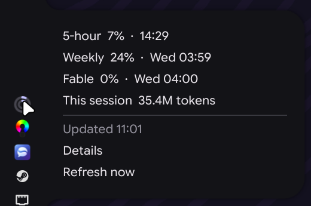
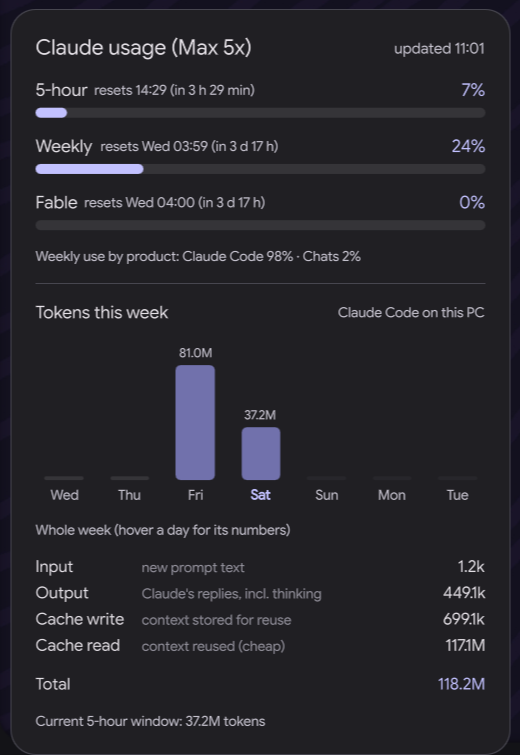

# claude-usage-tray

A tray icon and details panel showing your Claude plan usage limits (5-hour, weekly and
per-model, e.g. Fable) and your Claude Code token usage over the current week.
It's built for Hyprland with [Quickshell](https://quickshell.org), and themed to match the
[Caelestia](https://github.com/caelestia-dots/shell) shell.

<p>
  
  &nbsp;
  
</p>

- **Tray icon:** two rings. The outer one is the 5-hour limit and the inner one is the weekly limit.
  They're coloured by severity (normal, warning, critical) and turn grey when the data is stale.
- **Hover menu:** every limit with its reset time, tokens in the current 5-hour window, the last
  update, Details and Refresh now.
- **Left click:** a details panel next to the bar, showing your plan, the limit bars with reset
  countdowns, weekly use by product, and a per-day token chart for the weekly window, split into
  input / output / cache write / cache read. Click outside it or press Esc to close it.
- **Right click:** refresh now.

## How it works (read this)

- **Limits** come from `https://api.anthropic.com/api/oauth/usage`, the endpoint Claude Code's
  `/usage` command uses. It's **undocumented and may change or break without notice**.
- It authenticates with the login **Claude Code already stores** in `~/.claude/.credentials.json`,
  so there's nothing to log in to. The token is only ever sent to `api.anthropic.com`.
- It **never refreshes the token**: refreshing would rotate it under Claude Code. While the token
  is expired, the last result is shown marked stale, and it picks up again once Claude Code
  renews the login.
- **Token history** is read from local Claude Code transcripts (`~/.claude/projects/**/*.jsonl`).
  It only covers Claude Code on this machine. claude.ai usage counts toward the limits but isn't in
  the history. "Days" are 24-hour slices of the weekly limit window, starting at the weekly reset time.
- It polls the endpoint every 5 minutes (and on hover if the last check is over a minute old), and
  rescans transcripts every 60 seconds.

## Requirements

- Hyprland (the panel uses `hyprctl` and `HyprlandFocusGrab`)
- Quickshell (`qs`)
- A StatusNotifierItem tray host: Caelestia, Waybar, etc.
- Python 3 with `python-dbus`, `python-gobject`, `python-cairo`
- Claude Code, logged in with a Claude subscription

Without Caelestia it still works, using Catppuccin Mocha fallback colours and the Inter font.
With Caelestia it follows your current colour scheme (`~/.local/state/caelestia/scheme.json`)
and uses its font.

## Install

```bash
git clone https://github.com/xKirtle/claude-usage-tray
cd claude-usage-tray
./install.sh
```

This symlinks the files into place and enables the user service:

| Repo | Installed as |
|---|---|
| `claude-usage-tray` | `~/.local/bin/claude-usage-tray` |
| `panel/` | `~/.config/quickshell/claude-usage/` |
| `systemd/claude-usage-tray.service` | `~/.config/systemd/user/` (`graphical-session.target`) |

Uninstall with `./install.sh --uninstall`.

## Notes

- State shared with the panel: `~/.cache/claude-usage/state.json`. It also keeps the last good
  response across restarts.
- Intervals and colours are constants at the top of `claude-usage-tray`.
- The panel doesn't live-reload. After editing `panel/shell.qml`, run `qs -c claude-usage kill`
  and click the icon again.
- Logs: `journalctl --user -u claude-usage-tray`, `qs -c claude-usage log`.

## License

MIT
